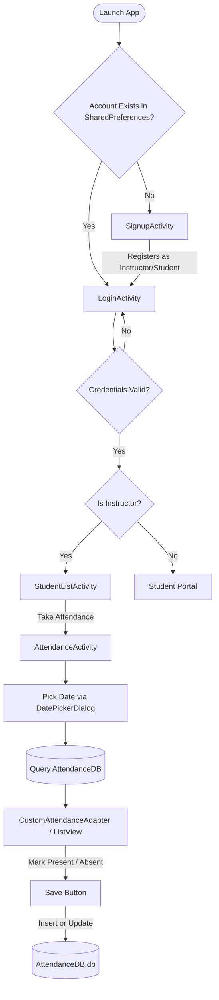

# AttendanceCloud - Student Attendance Management System

[](https://github.com/mehadishameem/AttendanceCloud)
[](https://developer.android.com/)
[](https://www.java.com/)
[](https://www.sqlite.org/)
[-brightgreen)](https://developer.android.com/)
[-green)](https://developer.android.com/)
[](https://developer.android.com/)
[-blueviolet)](https://www.ewubd.edu/)

**AttendanceCloud** is a mobile application developed for **East West University (EWU)** under course **CSE489 (Mobile Application Development)** for the Fall 2024 semester. The app simplifies classroom attendance tracking, role-based user management (Instructors and Students), and local attendance records storage using an embedded SQLite database.

---

## Table of Contents

- [Features](#features)
- [Application Flow & Architecture](#application-flow--architecture)
- [Database Schema](#database-schema)
- [Project Structure](#project-structure)
- [Tech Stack & Prerequisites](#tech-stack--prerequisites)
- [Getting Started](#getting-started)
- [Screens & Activities](#screens--activities)
- [Author & Acknowledgments](#author--acknowledgments)

---

## Features

- **Role-Based Authentication**:
  - Distinct sign-up flows for **Instructors** and **Students**.
  - Form validations including name character boundaries, regular expression email verification, phone digit lengths, and 4-digit PIN/password matching.
  - User session caching via Android `SharedPreferences` (`att_prefs`) with "Remember User" and "Remember Login" options.
  - Role-specific login restrictions (e.g. instructors cannot log in through the student portal and vice versa).

- **Attendance Tracking**:
  - Course-specific and section-specific record tracking (e.g. `CSE489`, `Section 2`).
  - Integrated **Date Picker Dialog** allowing attendance logging and reviewing for any selected date.
  - Interactive student list built with a custom `ArrayAdapter` (`CustomAttendanceAdapter`) displaying Serial Number, Student ID, Name, and Present/Absent radio options.
  - Intelligent save logic: checks if attendance was already recorded for the selected date—performing an **UPDATE** if records exist or an **INSERT** if registering for the first time.

- **Local Persistence with SQLite**:
  - Fast, offline-first data storage handled by `AttendanceDB` (`SQLiteOpenHelper`).
  - Composite primary key on `(ID, course, date)` ensuring accurate historical records per student per class session.

---

## Application Flow & Architecture



---

## Database Schema

The app utilizes an internal SQLite database (`AttendanceDB.db`, version 2):

### Table: `attendance`

| Column | Type | Constraints | Description |
| :--- | :--- | :--- | :--- |
| `ID` | `TEXT` | `PRIMARY KEY` (composite) | Student unique ID (e.g., `2022-1-60-001`) |
| `name` | `TEXT` | | Student full name |
| `course` | `TEXT` | `PRIMARY KEY` (composite) | Course code (e.g., `CSE489`) |
| `section` | `INT` | | Section number (e.g., `2`) |
| `date` | `INT` (Long) | `PRIMARY KEY` (composite) | Timestamp representing the class date in milliseconds |
| `status` | `INT` | `DEFAULT 0` | Attendance status: `1` = Present, `0` = Absent |

**Composite Primary Key**: `(ID, course, date)`

---

## Project Structure

```text
AttendanceCloud/
├── app/
│   ├── build.gradle.kts               # Module-level Gradle configuration
│   └── src/
│       ├── main/
│       │   ├── AndroidManifest.xml    # App manifest registering activities
│       │   ├── java/edu/ewubd/cse48920243/
│       │   │   ├── Attendance.java             # Data model for student attendance
│       │   │   ├── AttendanceActivity.java     # Attendance tracker & date selection
│       │   │   ├── AttendanceDB.java           # SQLiteOpenHelper for attendance table
│       │   │   ├── CustomAttendanceAdapter.java# Custom list adapter for student rows
│       │   │   ├── LoginActivity.java          # Authentication & credential validation
│       │   │   ├── SignupActivity.java         # User onboarding & validation
│       │   │   └── StudentListActivity.java    # Instructor main dashboard
│       │   └── res/
│       │       ├── layout/
│       │       │   ├── activity_attendance.xml   # Layout for taking attendance
│       │       │   ├── activity_login.xml        # Layout for login screen
│       │       │   ├── activity_signup.xml       # Layout for signup screen
│       │       │   ├── activity_student_list.xml # Layout for student list screen
│       │       │   └── row_attendance.xml        # List item layout with radio buttons
│       │       └── values/
│       │           ├── colors.xml
│       │           ├── strings.xml
│       │           └── themes.xml
├── build.gradle.kts                   # Project-level build script
├── gradle/wrapper/                    # Gradle wrapper files
├── settings.gradle.kts                # Project module definitions
└── README.md                          # Project documentation
```

---

## Tech Stack & Prerequisites

- **Language**: Java 8 (`sourceCompatibility = JavaVersion.VERSION_1_8`)
- **Android Target**: Android 13 (`targetSdk = 33`), Android 8.0 (`minSdk = 26`)
- **Compile SDK**: Android API 35
- **Build System**: Gradle with Kotlin DSL (`build.gradle.kts`)
- **UI Components**: AndroidX AppCompat `1.6.1`, Google Material Components `1.10.0`, ConstraintLayout `2.1.4`
- **Development Tool**: Android Studio (Flamingo / Giraffe / Hedgehog / Iguana or newer)

---

## Getting Started

### 1. Clone the Repository
```bash
git clone https://github.com/mehadishameem/AttendanceCloud.git
cd AttendanceCloud
```

### 2. Open with Android Studio
1. Launch **Android Studio**.
2. Select **File > Open...** and navigate to the cloned `AttendanceCloud` directory.
3. Allow Gradle to download dependencies and sync the project.

### 3. Build & Run
- Connect an Android device (via USB Debugging enabled) or start an Android Virtual Device (AVD) running API 26 or above.
- Click the **Run** button (or press `Shift + F10`) to build the APK and install it on your device.

---

## Screens & Activities

1. **Signup Screen (`SignupActivity`)**:
   - Collects Name, Email, Phone, and Password.
   - Allows choosing whether to register as an **Instructor** or **Student**.
   - Validates formats before storing account info into `SharedPreferences`.

2. **Login Screen (`LoginActivity`)**:
   - Authenticates against stored credentials.
   - Supports "Remember User" and "Remember Login" preferences.
   - Dual action buttons: "Login as Instructor" and "Login as Student".

3. **Student List Dashboard (`StudentListActivity`)**:
   - Central hub for instructors to view classes and navigate to attendance sessions.

4. **Attendance Marking (`AttendanceActivity`)**:
   - Displays course title and section.
   - Date selection via standard Android DatePicker.
   - Dynamic table view showing Student ID, Student Name, and Present/Absent toggle options.
   - Saves/updates attendance data in local SQLite database on demand.

---

## Author & Acknowledgments

- **Author**: [Mehadi Hasan Shameem](https://github.com/mehadishameem)
- **Repository**: [mehadishameem/AttendanceCloud](https://github.com/mehadishameem/AttendanceCloud)
- **Institution**: East West University (EWU)
- **Course**: CSE489 — Mobile Application Development (Fall 2024)
